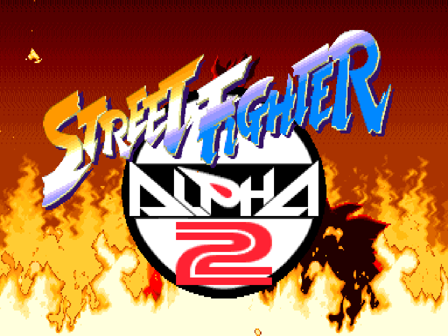
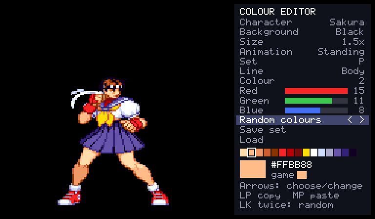
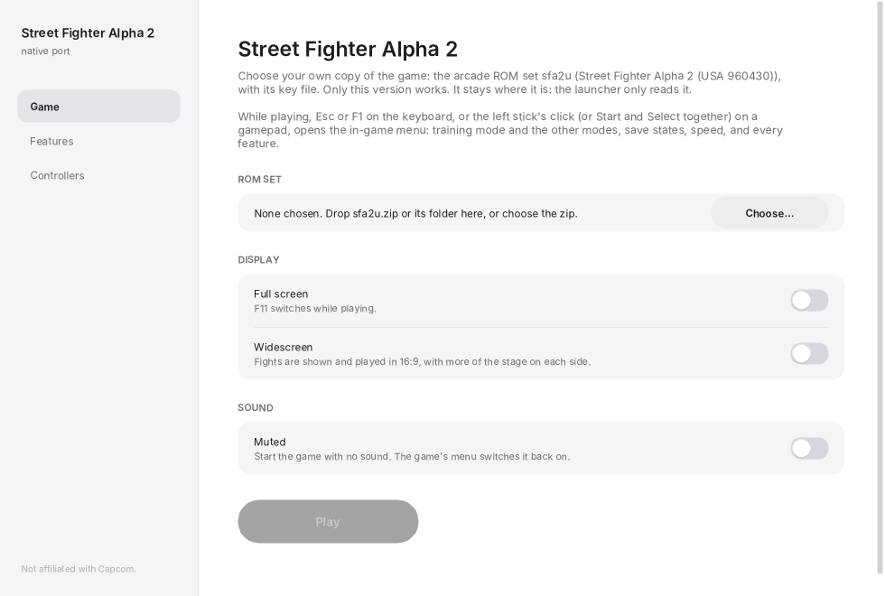
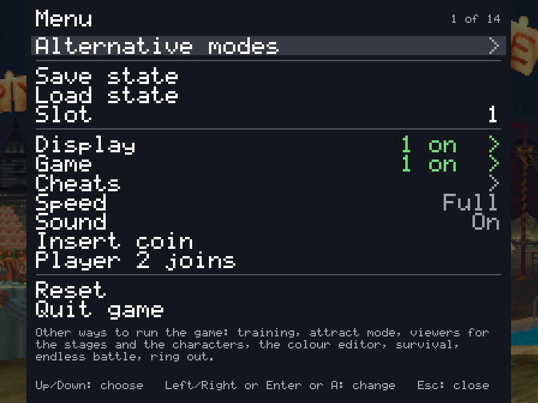
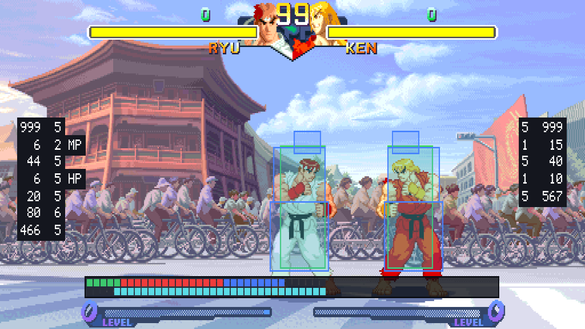
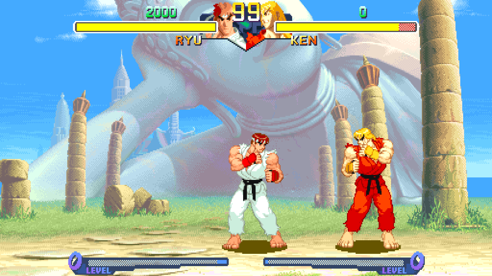
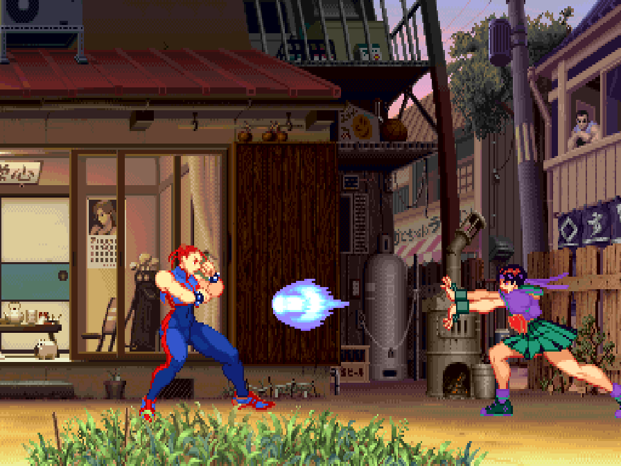
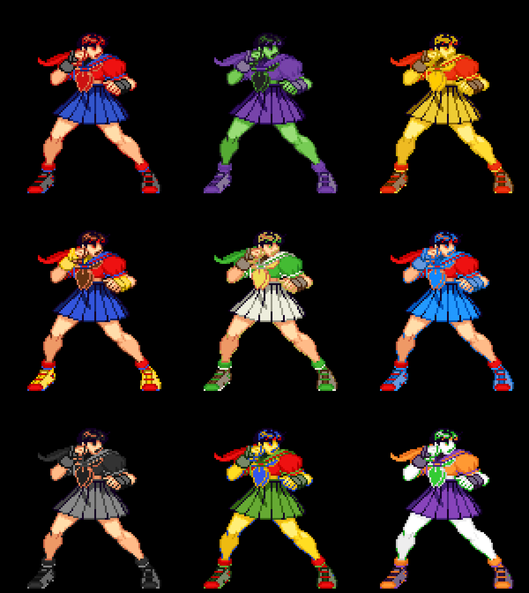
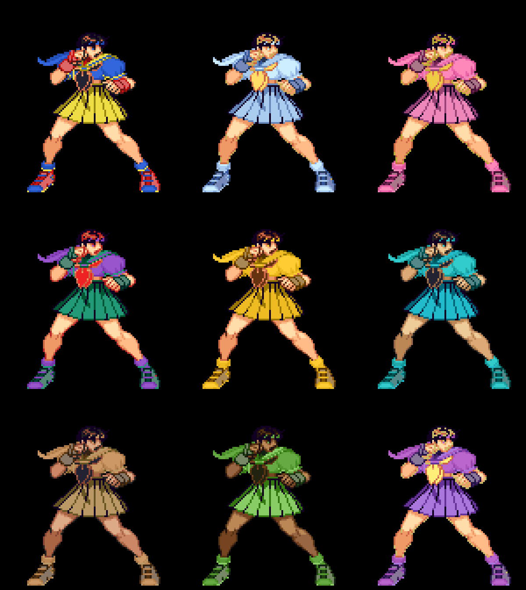

# Street Fighter Alpha 2 Recomp

An unofficial native PC port of the arcade game *Street Fighter Alpha 2* (Capcom, 1996, CPS-2 board) for
macOS, Linux (Steam Deck included) and Windows, made by static recompilation, with a full training mode:
the one thing no release of this game has ever had.

**[Get started: download it and play →](#playing)**

> **Beta.** The game plays from start to ending and its code is checked instruction by instruction, but
> it has been played on few machines and controllers yet. Expect rough edges, and please
> [report what you find](#feedback-and-contributing).

**No game files are included.** You need your own copy of the game: the arcade ROM set `sfa2u` (USA,
960430) with its key file, from a board you own. **Only that version works.** This project cannot help
you get one.

This project is not affiliated with, endorsed by, or sponsored by Capcom. *Street Fighter* is a trademark
of Capcom Co., Ltd.



### New: dress the characters in your own colours

A colour editor in the game, with the character in front of you: any of their six colour sets, 16 levels
each of red, green and blue, random colours at the press of a button, and a library of the sets you save.
Then choose the character with that button and fight in them. [More →](#custom-colours)



## What it is

The game's 68000 program is translated ahead of time into C++ and compiled into the port, and the parts the
training mode touches (the hit tests, the guard decision, the damage formula, the throw, the round's clock, the
camera, reading the controls, pushing apart, and the players' own state machine: 45 routines) are rewritten by
hand as readable C++, each checked call by call against the game's own code. What the program expects of the
board (its video, the QSound chip, the sound CPU and its registers) is code written for this project, not an
emulator ([how it works](docs/PORT.md)).

- Plays with a keyboard, a gamepad or an arcade stick; every key and button can be changed, for each player, in
  the launcher.
- An in-game menu (Esc or `F1`; on a gamepad, the left stick's click or Start and Select together) with the
  training mode and the other modes, save states, speed, the cheats and every feature.
- **Pure** plays exactly as the board does. **Enhanced** (the default) adds free play and your own
  [character colours](#custom-colours). Every other feature is a switch of its own.
- The board's operator settings (difficulty, damage level, timer speed, game speed, rounds and the
  rest) on the Board page (launcher's Features, in-game menu), each as the board is set unless you
  choose; or the game's own test menu from the in-game menu.
- **Straight to the title** (on the Game page): at a start or a reset, everything before the title (the
  board's start, the warning, the notices and the introduction) runs unseen; with a coin in or free play, the
  picture comes back with the title that asks for Start.
- A search box on the launcher's Features page (Ctrl+F or Cmd+F) finds any feature by a word in its
  name, description or choices.
- Your ROM set is only ever read. Settings, save states and the board's settings memory go in your own user
  folder.

| | |
| --- | --- |
|  |  |
|  |  |

## Training mode

The one thing no release of Street Fighter Alpha 2 has had. "Alternative modes" at the top of the in-game menu
has a Training mode page: Start goes straight to the character choice with two players (player 1's controls
choose for both) and into a fight with no clock that nobody loses, and the page holds the aids below.

| Feature | What it does |
| --- | --- |
| Hit boxes | The boxes the game itself tests: where a player can be hit (blue), attacks (red; orange for things thrown), pushing boxes (green) |
| Throw range | The zone in front of each player that the other's push box has to reach for a throw, as the game tests it |
| Frame data and frame meter | Startup, active and recovery of each move and the advantage after a hit or a guarded hit, counted in the game's own steps; a row of cells for each player, one a step; optionally every move written to `frame_data.csv` beside the settings |
| Input display | What each player presses and for how long, in numpad notation from the player's side |
| Combo readout | Hits and damage of a combo, the round's best |
| Custom Combo time | How long a Custom Combo has left |
| Stun readout | How much stun each player has taken, against how much stuns them |
| Fixed damage | No random part in a hit's damage (the average in its place), so a combo always does the same |
| Health refills | Health comes back when a player has not been hit for a moment |
| The dummy | Stands, crouches, jumps; guards (always, after a hit, at random; high or low by the game's own rule for each attack); Alpha counters (punch or kick) while guarding; softens throws; quick rise after a knock-down; or played by the game's own computer player; records and replays in three slots (one, or any at random), and can answer with a recording after guarding or being hit |
| Start over | The round as it began, in the middle or a corner, sides swapped or not (Backspace, or a gamepad's left shoulder) |
| Stage | Any of the eighteen stages, or the game's own choice |
| Stop, step, slow | Stop the game, go on a frame at a time, or play at a half, a quarter or an eighth of the speed |

The frame data matches SuperCombo's published startup and active frames for Ryu's normals.

Also: save states in nine slots, free play, and cheats (no damage, one-hit knockouts, full gauge, infinite
time, no stun). [docs/FEATURES.md](docs/FEATURES.md) has the whole list.



## Alternative modes

The in-game menu's first row, "Alternative modes", has ways of playing and watching the game that the board
does not have. Each has a page with a Start row and its own choices, and runs until another is started or the
menu's Reset.

| Mode | What it does |
| --- | --- |
| Training mode | A fight with no clock that nobody loses, and the aids above |
| Attract mode | The game's own show on a loop: everything, the introduction only, or one demonstration fight after another |
| Stage viewer | Any of the eighteen stages with nobody on it and no panel, scrolled with the stick or by itself, with any tune; "Infinite" scrolls through every stage in turn |
| Model viewer | One character by itself, on a stage or on plain white or black, from a quarter of its size to 25 times. It stands and moves with your controls, or goes through any of its animations (named A0, B12, C3... as the game's own lists number them; left and right step through them), over and over or all of them one after another (Play all), at full speed or in slow motion. At its own size, what the stage has in front of the fighters stays in front |
| Colour editor | Change a character's colours while you watch: [custom colours](#custom-colours) |
| Survival | One computer opponent after another on the health you have left. How many can you beat? |
| Endless battle | Two fighters the game plays, for as long as you like, with no bars and no clock, on one stage, on stages that fade one into another, or on a floor that scrolls through them all. Touch the controls to take a fighter over |
| Ring out | No health. Knock your opponent over the end of the stage and jump down to the next one |

## Widescreen



A switch on the launcher's first page, under "Full screen" (and on the in-game menu's Display page). Fights are
shown and played in 16:9: the picture is 512 columns wide where the board's is 384, at the same height and with
everything the same size, so there is a third more of the stage in view.

It is **off unless you switch it on**, in every preset, because it changes how the game plays:

- The players can go to the wide picture's edges, so they can stand further apart than on the board. The
  stage's own ends are where they were.
- The camera stops 64 short of where it did, so that the picture ends where the stage does.
- The bars, the clock and the gauges stay in the middle. Survival, the endless battle, the stage and model
  viewers and everything that is not a fight keep the board's 4:3.

With it off the game is exactly the board's. Nothing here stretches the picture: the extra columns are the
game's own stage art, which the board already holds and never showed, and on all eighteen stages they are
painted to the camera's ends.

**Invisible walls**, on the Display page (launcher's Features, in-game menu), keeps the 16:9 picture and plays the game exactly as the
board does: the players are stopped where the board's picture ends, by walls that are not seen, and the camera
goes as far as the board's. Near a stage's end the view stays on the stage, so the play area is then to one side
of the wide picture. The game's memory is the same as with widescreen off, frame for frame (`make
check-widescreen` compares it along the ladder).

## The picture

The Display page (in the launcher and the in-game menu) says how the picture fits the window or screen:

| Row | Choices |
| --- | --- |
| Scaling | Sharp (each pixel a crisp block), Whole pixels (every pixel the same whole number of the screen's pixels tall, a border round it), Smooth |
| Picture shape | 4:3 (as the arcade's monitor showed it), Square pixels, Fill |
| Window size | 3x the board's 224 lines, or 2x to 6x |

The first of each is the default, and how it has always been drawn.

## Custom colours

Give any character colours of your own: change them in the game's colour editor, or bring files someone else
made.

| | |
| --- | --- |
|  |  |

Sakura in eighteen sets of colours made with the editor:

| | |
| --- | --- |
|  |  |

**The colour editor** is on the in-game menu's "Alternative modes" page. It shows the character with a panel at
the right, worked with player 1's controls: up and down choose a row, left and right change it.

- **Character, background, size, animation**: who you are dressing, on what, how large, standing or going
  through one of their animations.
- **Set**: which of the character's six colour sets, by how it is chosen at the character choice: a punch (P),
  a kick (K), two punches together (PP), two kicks together (KK), and the two used with auto guard (AUTOP,
  AUTOK).
- **Line**: the character's own colours, or one of four lines for their effects (fireballs, the super combo's
  trail). Choosing a line shows an animation that uses it, found in the first seconds the editor shows a
  character.
- **Colour, Red, Green, Blue**: one of the line's 15 colours (it blinks on the character when you choose it),
  and its red, green and blue in the board's 16 levels each.
- **Random colours**: every colour of the set at random, at a second press on its row (LK, left or right,
  twice), so that one press by mistake loses nothing. HK puts back the colours from before the random ones,
  until the next change.
- **Save set** and **Load**: keep a set you like in the character's library and put it back later, into this
  set or any other. Left and right on Load try each saved one on the character; LP loads it, MK twice deletes
  it, and moving off the row without loading puts your colours back.
- LP copies a colour, MP pastes it, HP gives back the game's; the menu page puts back the game's colours for the
  whole set or the whole character.

Changes show at once and are saved as you go. **To play in them, choose the character with the button of the
set you changed** (Sakura with a punch, say), anywhere: arcade, versus, training.

**Files.** What you change goes in a `palettes` folder beside `settings.ini`, a text file a character
(`Sakura.txt`) holding only the sets that are not the game's. The folder is:

| System | Folder |
| --- | --- |
| Windows | `%APPDATA%\Street Fighter Alpha 2\palettes` (paste it into Explorer's address bar; it is the `AppData\Roaming` folder in your user folder) |
| macOS | `~/Library/Application Support/Street Fighter Alpha 2/palettes` |
| Linux, SteamOS | `~/.local/share/Street Fighter Alpha 2/palettes` |

You can write or share them by hand: "Write the game's colours" (on the colour editor's page of the menu) puts
every character's own colours in `palettes/original` to start from, each set up to five lines of 16 colours
(`#RRGGBB` or `#RGB`; `-` keeps the game's). Saved sets are files too, one a set, in
`palettes/library/<Character>/` (`Sakura 1.txt`, `Sakura 2.txt`...): to share a design, share its file, and to
use one someone gave you, put it in that folder. The format is the same as Vampire Savior Recomp's.

**PalMod.** A copy of your set's `sz2u.07` changed with [PalMod](https://github.com/Preppy/PalMod) can go in
`palettes` too (never the one in your ROM set): only the characters' colours are taken from it, so it cannot
change how the game plays, and text files go over it. This has not been tried with PalMod itself yet, and
PalMod's own tables for this game may point elsewhere in the file: if your colours do not show, please
[report it](#feedback-and-contributing).

"Load colour files again", on the same page, reads files you changed while the game runs. "Custom colours" on
the Display page switches all of it: on in Enhanced (it changes nothing until there are files), off in Pure.

## What you need

- The ROM set `sfa2u` (*Street Fighter Alpha 2*, USA 960430): `sfa2u.zip` (with `sfa2.zip` beside it if
  your collection keeps the shared files there) or a folder with the set's files, including `sfa2u.key`.
  The launcher checks every file by checksum and tells you which is missing or different. Sets of other
  regions and revisions are refused: the port is made from this one version's program, and its training
  features use addresses found in it.
- One of: macOS 13 or later (Apple silicon or Intel); Linux x86_64 or SteamOS; Windows 10 or 11, 64-bit.
- A gamepad or stick with six buttons is recommended.

## Playing

1. Download the build for your system from the [releases page](../../releases) and unpack it.
2. Open the launcher (`Street Fighter Alpha 2 Recomp.app`, `sfa2-launcher`) and drop your ROM set on it,
   or choose it. It stays where it is.
3. Press **Play**.

While playing, Esc or `F1` (on a gamepad, the left stick's click, or Start and Select together) opens the
in-game menu. The launcher's Controllers page changes any key or button, for each player, and lists the
other keys. Only the menu's "Quit game" row (or closing the window) ends the game.

macOS: the app is not notarized, so the first time, right-click it and choose Open.
Linux: unpack the archive anywhere and run `sfa2-launcher`.
Windows: run `sfa2-launcher.exe`. Opening `sfa2.exe` by itself starts the launcher too (straight into the
game once a ROM set has been chosen).

### Steam Deck

1. Hold the power button and choose **Switch to Desktop**.
2. Download `StreetFighterAlpha2-linux-x86_64.tar.gz` from the [releases page](../../releases). In the
   file manager (Dolphin), right-click it and choose **Extract → Extract archive here**, then move the
   `StreetFighterAlpha2` folder where it can stay (for example a new `Applications` folder in your home
   folder). If you move it later, do step 5 again.
3. Copy your ROM set (`sfa2u.zip` with its key file, or its folder) onto the Deck, for example from a USB
   stick or the SD card.
4. In the `StreetFighterAlpha2` folder, open `sfa2-launcher` and choose your ROM set (or drop it on the
   window).
5. On the launcher's Game page, press **Add to Steam**. It adds two entries to your library: **Street
   Fighter Alpha 2** (straight into the game) and **Street Fighter Alpha 2 Launcher** (the ROM set,
   features and controls).
6. Go back to Gaming Mode with the **Return to Gaming Mode** icon on the desktop. Both are in your Library
   under **Non-Steam**.

In the game, click the left stick, or press View and Menu together (the two buttons either side of the
screen's top), to open the in-game menu; its "Quit game" row ends the game.

## Building from source

With your own ROM set in `rom/` (ignored by Git), CMake, Ninja, SDL 3 and Python 3:

```sh
make            # twice the first time
make explore    # once, about ten minutes: finds the game's code by made-up play and translates it
make run
```

[docs/BUILDING.md](docs/BUILDING.md) has every platform, the checks and the release builds;
[docs/PORT.md](docs/PORT.md) says how the port works, and `games/sfa2/PROGRESS.md` what was found about the
game and what is left.

## Feedback and contributing

Bug reports and pull requests are welcome: see [CONTRIBUTING.md](CONTRIBUTING.md) for the rules (above
all: nothing from the game, ever) and [docs/ROADMAP.md](docs/ROADMAP.md) for what is next.

## License and credits

GPL-3.0-only (see [LICENSE](LICENSE)). [THIRD_PARTY_NOTICES.md](THIRD_PARTY_NOTICES.md) lists what comes
from other projects: the CPS-2 program cipher is MAME's (BSD-3-Clause; worked out by Andreas Naive and
Nicola Salmoria), the QSound model follows MAME's high-level one (superctr, Valley Bell), the hardware
facts follow MAME's CPS-2 driver, and the launcher's look comes from arelkair's wiiparty-recomp. SDL 3,
Dear ImGui and the Inter font are used by the programs.

The repository holds no game data and nothing derived from it.
